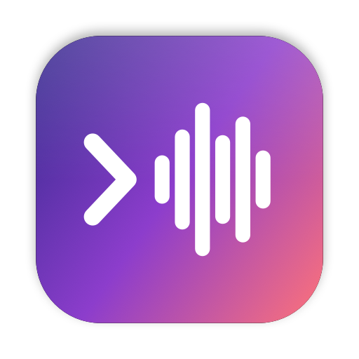

<p align="center"></p>

# VoxDesk

Local dictation for the Mac menu bar. Hold or tap a shortcut, speak, and the text is pasted where you are
typing, Terminal and iTerm2 included. Speech is recognised on the Mac, on the Neural Engine, and nothing
leaves the machine.

Two engines, picked in the menu:

- **Fast English** (default): NVIDIA's Parakeet TDT 0.6B v2 through [FluidAudio](https://github.com/FluidInference/FluidAudio).
  The text appears about 0.15 s after you let go, even after 15 s of speech. Your vocabulary list is applied
  as keyword boosting.
- **Multilingual**: OpenAI's Whisper large-v3-turbo through [WhisperKit](https://github.com/argmaxinc/argmax-oss-swift),
  for Hindi, Hinglish and the other Whisper languages. About 1 s after you let go.

Only the selected engine is loaded and kept warm.

## Requirements

- Apple Silicon (M1 or later)
- macOS 14 or later
- Xcode command-line tools (`xcode-select --install`). Swift 6.2 or later (the Xcode 26 tools) builds both
  engines; an older Swift builds the Multilingual engine only.

## Install

With Homebrew:

```sh
brew tap YashSharmaa/tap && brew trust yashsharmaa/tap && brew install voxdesk
cp -R "$(brew --prefix voxdesk)/VoxDesk.app" /Applications/
```

Or with the install script, which checks the requirements, builds from source and installs
`/Applications/VoxDesk.app`:

```sh
curl -fsSL https://raw.githubusercontent.com/YashSharmaa/voxdesk/main/install.sh | bash
```

From a checkout: `./build.sh` builds and signs `/Applications/VoxDesk.app` (`./build.sh ~/Applications` for
elsewhere). Signing uses `VOXDESK_SIGN_IDENTITY` if set, else the first "Apple Development" or
"Developer ID Application" identity in your keychain, else ad hoc. A real identity is better: macOS ties the
Microphone and Accessibility grants to it, and ad hoc signatures change on every build.

On first launch VoxDesk asks for the Microphone (to hear you) and Accessibility (to paste with Cmd+V).

## Use

- **Option+Space** (change it in the menu): tap to start and tap again to finish, or hold to talk and let go.
  A release within 280 ms is a tap. "Hold Right Option" is the other trigger.
- The overlay at the bottom of the screen shows the waveform and the text so far. It never takes focus.
- On finish the text is pasted and your clipboard is put back about 150 ms later, unless
  "Keep text on the clipboard" is on.
- **Engine**: Fast English (Parakeet) or Multilingual (Whisper). With Multilingual you also pick the language
  (auto-detect, English, Hindi in Devanagari, or Hinglish in Roman script) and the Whisper model.
- **Vocabulary**: words you use often. Fast English writes them your way where the audio supports them;
  Whisper reads them as the sentence before your dictation.
- Silence and noise paste nothing: an energy gate, then Silero VAD, then a filter for stock phrases.
- Launch at login is a toggle in the menu.

### Command line

```sh
VoxDesk --version
VoxDesk --transcribe clip.wav [more.m4a] [--engine parakeet|whisper] [--model ID]
                     [--language auto|en|hi|hinglish] [--vocab "a, b"] [--no-vocab]
                     [--repeat N] [--stream] [--json]
VoxDesk --self-test
scripts/make-test-audio.sh   # test clips made with `say -o` and ffmpeg (plays nothing)
```

The binary is `/Applications/VoxDesk.app/Contents/MacOS/VoxDesk` (Homebrew links it as `voxdesk`).
`--transcribe` runs the app's pipeline on files and prints the text, with timings on stderr. `--stream`
replays a file in real time through the same live path the app uses while you speak, and reports the time
from the end of the audio to the final text.

## Model downloads

Downloaded from Hugging Face on first use of each engine:

| Engine | Model | Size | Kept in |
|---|---|---|---|
| Fast English | Parakeet TDT 0.6B v2 (Core ML) | 451 MB | `~/Library/Application Support/FluidAudio/Models` |
| Fast English | Parakeet CTC 110M, for vocabulary boosting | 98 MB | same |
| Multilingual | Whisper large-v3-turbo (Core ML) | 626 MB, or 547 / 216 / 150 MB for the smaller choices | `~/Library/Application Support/VoxDesk/Models` |
| Both | Silero VAD v6 | 2 MB | `~/Library/Application Support/VoxDesk/VAD` |

Core ML compiles each model for your Mac on first load, which takes a few seconds (up to a minute for Whisper).

## Speed

Measured on an M5 Max from the end of a 15.4 s spoken paragraph to the final text, with the app's live path
(`--stream`):

| Engine | End of speech to text | Memory (peak footprint) |
|---|---|---|
| Fast English | 0.14 to 0.16 s | about 80 MB |
| Multilingual | 1.03 s | about 510 MB |

## Privacy

Everything runs on your Mac. Audio is recorded only while the shortcut is active, is never written to disk,
and neither audio nor text is sent anywhere. The only network use is downloading the models above. There is
no telemetry and no account.

## Credits

- [Parakeet TDT 0.6B v2](https://huggingface.co/nvidia/parakeet-tdt-0.6b-v2) and
  [Parakeet TDT-CTC 110M](https://huggingface.co/nvidia/parakeet-tdt_ctc-110m) by NVIDIA, CC-BY-4.0, in
  FluidInference's Core ML builds.
- [FluidAudio](https://github.com/FluidInference/FluidAudio) by FluidInference, Apache-2.0.
- [Whisper](https://github.com/openai/whisper) by OpenAI, MIT, and [WhisperKit](https://github.com/argmaxinc/argmax-oss-swift)
  by Argmax, MIT.
- [Silero VAD](https://github.com/snakers4/silero-vad), MIT.
- [KeyboardShortcuts](https://github.com/sindresorhus/KeyboardShortcuts) by Sindre Sorhus, MIT.

See [THIRD_PARTY_NOTICES.md](THIRD_PARTY_NOTICES.md). VoxDesk itself is MIT licensed ([LICENSE](LICENSE)).
